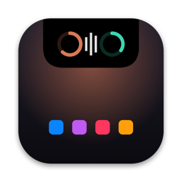
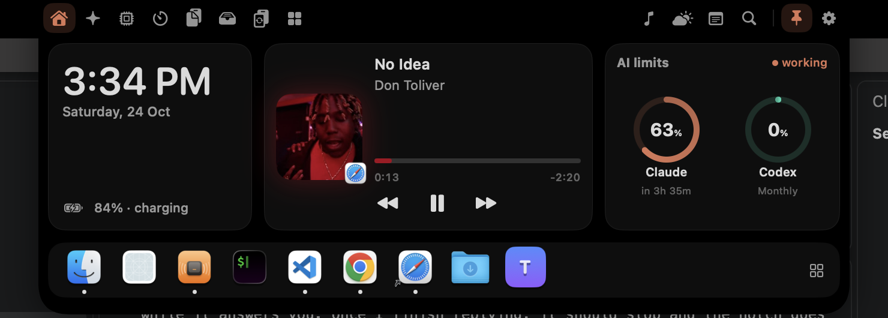
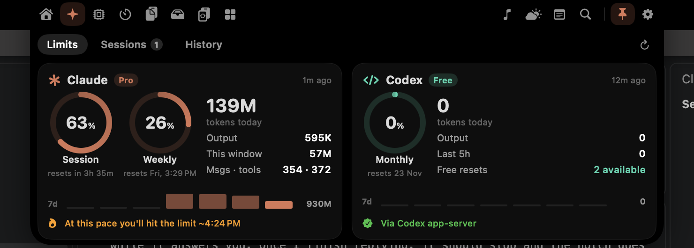
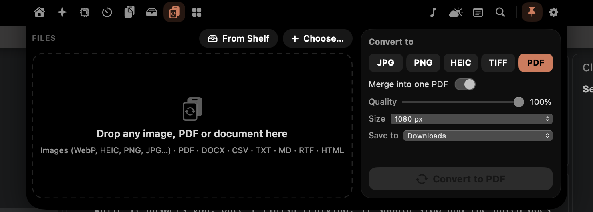

<p align="center"></p>

<h1 align="center">MyNotch</h1>

<p align="center">
<b>Your MacBook notch, turned into a command center.</b><br>
Live Claude Code &amp; Codex limits, your apps, music, clipboard, shelf, file converter and more — one hover away.
</p>

<p align="center">
<a href="../../releases/latest"></a>


</p>

<p align="center"></p>

---

## Download

1. Grab **`MyNotch.dmg`** from the [latest release](../../releases/latest).
2. Open it and drag **MyNotch** into **Applications**.
3. First launch: macOS will say it can't verify the developer (the app isn't notarized yet).
   - **Right-click MyNotch → Open → Open**, or
   - System Settings → Privacy & Security → **Open Anyway**, or
   - Terminal: `xattr -dr com.apple.quarantine /Applications/MyNotch.app`
4. Move your pointer to the notch. That's it.

> Requires macOS 14 Sonoma or later and an Apple Silicon Mac. Macs without a notch get a simulated one.

## Features

### ✳︎ AI usage — Claude Code & Codex


- **Real plan limits**, not estimates: Claude's 5-hour session % and weekly %, with reset times (the same numbers `/usage` shows).
- **Pace forecast** — "at this pace you'll hit the limit ~4:24 PM".
- **Codex limits** through the official `codex app-server`, including free resets.
- Tokens today, this window, messages, tool calls, 7-day trend, 14-day chart, streak heatmap, per-project breakdown.
- **Live sessions** — see which agents are working, idle or waiting for you; click to jump to the terminal.
- **Closed-notch live activity** — the Claude spark spins with your session % while an agent works; ✋ when it needs you.
- Banners when an agent **finishes**, **needs input**, or you cross **80%** of your session.

### 🗂 Everything else

| Tool | What it does |
|---|---|
| **Home** | Clock, next meeting, mini player, AI rings, your dock |
| **Apps** | Pinned apps, folders, files and sites. Drop files on an app icon to open them with it |
| **System** | CPU, memory, disk, network, battery health + cycles, local screen time. Warns when CPU or memory stays high |
| **Timers** | Pomodoro, multiple countdowns, lap stopwatch, hydration reminders |
| **Clipboard** | Grid with big previews, filters, multi-select, **Paste N into the app you were in**. Images paste into Claude Code / Codex as `[Image #N]`. Auto-cleans after 3 days |
| **Shelf** | Drag files onto the notch from anywhere, drag them back out later. AirDrop zone |
| **Convert** | WebP/HEIC/PNG/JPG/… ⇄ JPG, PNG, HEIC, TIFF · images → PDF · PDF → images · merge PDFs · **DOCX, CSV, TXT, MD, RTF, HTML → PDF**. Everything lands in `Downloads/MyNotch Converted/` |
| **Notes** | Quick-thought box + notes. Press **⌃⌥J** anywhere to jot something down |
| **Now Playing** | Any player — Spotify, Music, YouTube in your browser — with artwork and scrubbing |
| **Weather · Search · Calendar · Converter · Sounds · Mirror** | Optional; turn them on in Settings › Tools |

<p align="center"></p>

### ⌨️ Fast by design
- **Hover** the notch to open it; **hover a tab icon** to switch tools.
- **Drag tab icons** to reorder them.
- **Your own shortcut** — including two-step ones like `⌃N` then `O`.
- From the shortcut, the keyboard is yours: **← →** switch tools, **↓/Return** go in, **Esc** closes. On Notes, just start typing.
- Pin the notch open with the 📌 button.

### 🎨 Customizable
Themes (Midnight, Glass, Neon, Aurora), accent colors (including from album art), panel size, which tools show and in what order, every live activity, hover/close delays, haptics, clipboard retention, and more.

## Automation

Anything that can open a URL can talk to the notch:

```sh
open -g "mynotch://open?tool=ai"
open -g "mynotch://task?state=done&title=Build&seconds=134"   # banner when a build finishes
open -g "mynotch://task?state=failed&title=Tests"
open -g "mynotch://peek?title=Deployed&symbol=rocket.fill"
open -g "mynotch://convert?file=/path/a.png&to=pdf&run=1"
open -g "mynotch://ticker?text=On%20a%20call"
```

## Privacy

Everything stays on your Mac. MyNotch reads the files Claude Code and Codex already keep (`~/.claude`, `~/.codex`) and calls only:
- Anthropic's usage endpoint with the token Claude Code already stores (never refreshed or saved by MyNotch),
- Open-Meteo for weather and frankfurter.dev for currency rates, if you use those tools.

No analytics, no accounts, no telemetry.

## Permissions (all optional)

| Permission | Used for |
|---|---|
| Accessibility | Auto-paste from the clipboard; replacing the system volume/brightness HUD |
| Calendar | Agenda and meeting join buttons |
| Location | Local weather (or type a city) |
| Camera | Mirror tool, only while it's open |

## Build from source

Only Xcode **Command Line Tools** are needed (Swift 5.10+).

```sh
git clone https://github.com/wenayy/mynotch.git
cd mynotch
./scripts/build.sh install      # builds MyNotch.app, installs to /Applications and launches
./scripts/package.sh            # builds build/MyNotch.dmg
```

### How it works
- **Notch window** — a non-activating `NSPanel` above the menu bar, sized from `safeAreaInsets` / `auxiliaryTopLeftArea`; mouse monitors toggle `ignoresMouseEvents` so clicks pass through everywhere else.
- **Now Playing** — since macOS 15.4 MediaRemote only answers Apple-signed processes, so a tiny bridge (`Bridge/MediaBridge.m`) runs inside `/usr/bin/perl` and streams JSON.
- **Claude** — `api.anthropic.com/api/oauth/usage` + live status from `~/.claude/sessions` + an incremental memory-mapped parser over `~/.claude/projects/**/*.jsonl`.
- **Codex** — `codex app-server` JSON-RPC (`account/rateLimits/read`), falling back to session logs.

## Roadmap
- Signed & notarized builds, auto-update
- Intel / universal build
- More agents (Gemini CLI, Cursor…)

Issues and PRs welcome.

## Credits
Inspired by [boring.notch](https://github.com/TheBoredTeam/boring.notch), Notchix and NotchBuddy. Usage-endpoint research thanks to [CodexBar](https://github.com/steipete/CodexBar).

## License
[MIT](LICENSE)
